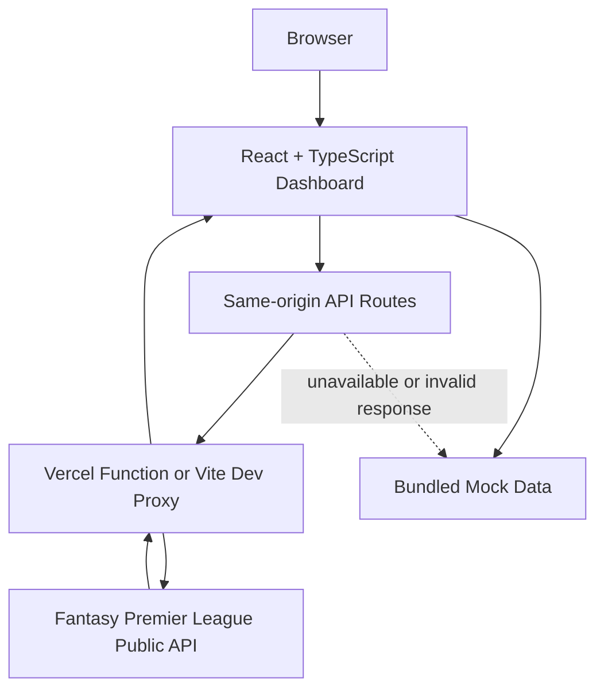
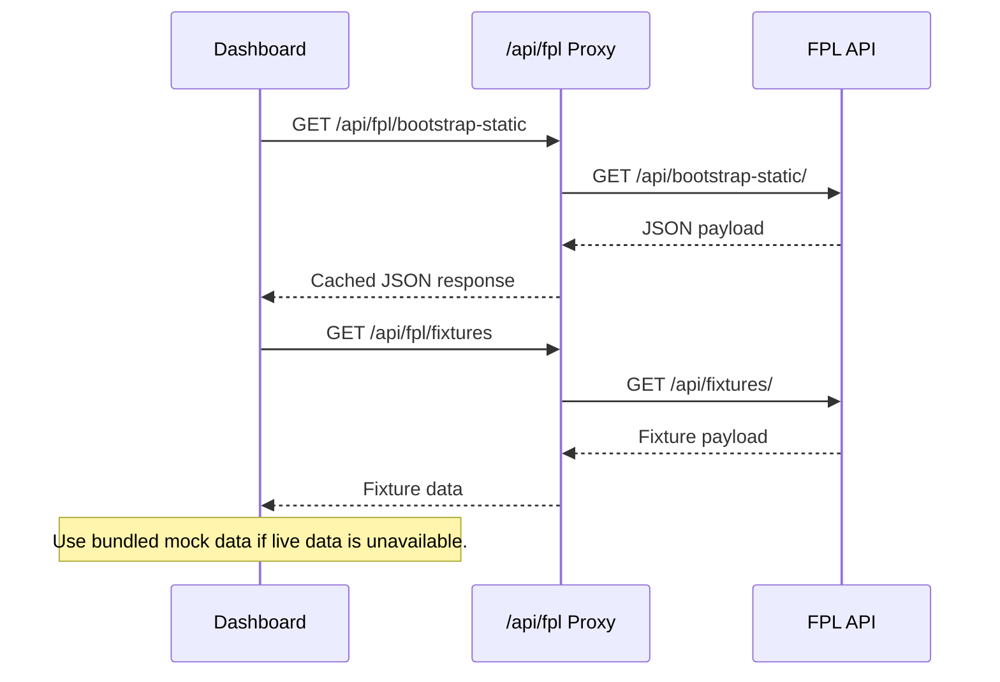

# FPL Analytics Dashboard

A Fantasy Premier League analytics dashboard built with **React, TypeScript, and Vite**. It transforms public FPL data into tools for exploring player statistics, comparing players, reviewing fixtures, and planning a squad.

## Overview

The dashboard requests public Fantasy Premier League data through a same-origin proxy. This avoids browser cross-origin restrictions and limits the upstream endpoints exposed to the client. If live data cannot be loaded, the application falls back to bundled mock data so the interface remains explorable.

## Features

- FPL overview with gameweek and player information.
- Player explorer with search, team and position filters.
- Sorting by total points, price, form, goals, and assists.
- Player detail view with on-demand gameweek history and performance trends.
- Head-to-head player comparison.
- My Team view using manager team-pick data.
- Captain selection helper.
- Value finder.
- Fixture Difficulty Rating (FDR) planner for upcoming gameweeks.
- Live-data loading with offline mock-data fallback.
- Responsive React interface styled with Tailwind CSS.

## Architecture



### Data request flow



## Technology stack

| Area | Technology |
| --- | --- |
| UI | React 19 |
| Language | TypeScript |
| Build tooling | Vite 8 |
| Styling | Tailwind CSS 4 |
| Icons | lucide-react |
| Data source | Public Fantasy Premier League API |
| Local proxy | Vite dev-server proxy |
| Production proxy | Vercel Functions |
| Quality tools | TypeScript, ESLint |

## Getting started

### Prerequisites

- Node.js 22.12 or later.
- npm.

### 1. Clone and install

```bash
git clone https://github.com/robinmwaniki/fpl_analytics_Dashboard.git
cd fpl_analytics_Dashboard
npm install
```

### 2. Run locally

```bash
npm run dev
```

Open the local URL printed by Vite, normally [http://localhost:5173](http://localhost:5173). The Vite configuration proxies supported requests to the public FPL API during development.

### 3. Build and validate

```bash
npm run typecheck
npm run lint
npm run build
npm run preview
```

## Data sources and fallback behavior

| Client request | Upstream endpoint |
| --- | --- |
| `/api/fpl/bootstrap-static` | `https://fantasy.premierleague.com/api/bootstrap-static/` |
| `/api/fpl/fixtures` | `https://fantasy.premierleague.com/api/fixtures/` |

The Vercel function allows only the configured endpoint names and applies a short shared-cache policy to successful responses. The local Vite proxy mirrors the production routing behavior.

If live bootstrap data is unavailable or does not match the expected shape, the dashboard uses bundled mock data and generated mock fixtures. Mock data is illustrative and must not be interpreted as current FPL statistics.

The repository also contains a local proxy for manager team picks. Production availability depends on the corresponding Vercel function being deployed with the project.

## Deployment

The repository includes Vercel Function code under `api/`.

1. Import the repository into Vercel.
2. Select the Vite framework preset.
3. Set the build command to `npm run build`.
4. Set the output directory to `dist`.
5. Keep the root-level `api/` directory so Vercel can detect the serverless functions.
6. Deploy and verify the dashboard and `/api/fpl/` endpoints.

The current public endpoints do not require an API key. Upstream availability and response formats can change independently of this project.

## Project structure

```text
.
├── api/
│   ├── fpl/             # Server-side FPL API proxy
│   ├── team-picks.ts    # Manager team-picks proxy
│   └── player-history.ts # Selected-player history proxy
├── src/
│   ├── components/      # Dashboard UI components
│   ├── services/        # FPL, manager and player-history data access
│   ├── types/           # FPL domain types
│   ├── App.tsx          # Dashboard views and state
│   └── main.tsx         # React entry point
├── index.html
├── package.json
└── vite.config.ts
```

## Disclaimer

This is an independent community-built project and is not affiliated with, endorsed by, or officially connected to the Premier League or Fantasy Premier League. Product names and data remain the property of their respective owners. Verify important decisions against the official FPL website.

## License

No license file is currently declared. Unless a license is added, standard copyright restrictions apply.

## Maintainer

**Robin Mwaniki** · [GitHub](https://github.com/robinmwaniki)
