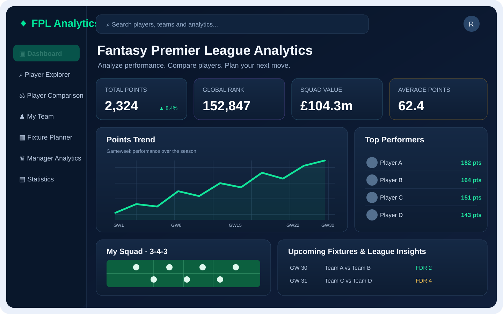
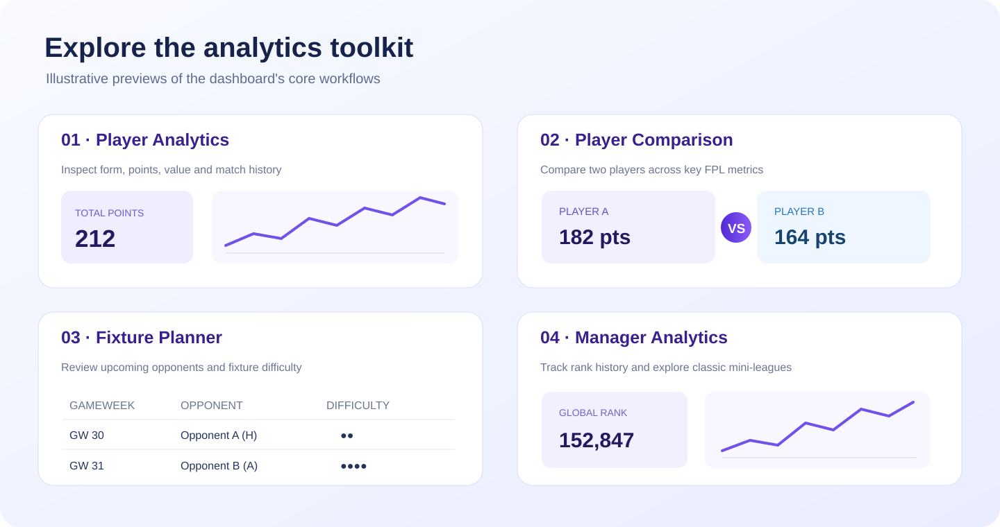
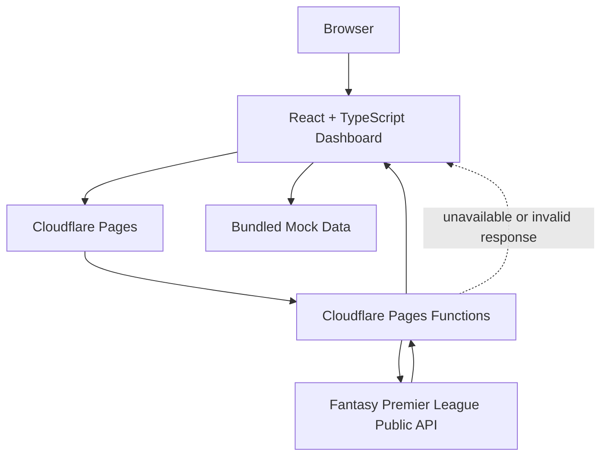

# FPL Analytics Dashboard

A Fantasy Premier League analytics dashboard built with **React, TypeScript, and Vite**. It transforms public FPL data into tools for exploring player statistics, comparing players, reviewing fixtures, and planning a squad.

<p align="center">
  
</p>

<p align="center">
  <strong>Explore player performance · Compare options · Plan fixtures · Track managers</strong>
</p>

> **Visual note:** The images in this README are conceptual illustrations created to showcase the product's intended workflows and feature areas. They are not screenshots captured from a running deployment, and sample names, values and charts shown in them are illustrative rather than live FPL data.

## Overview

The dashboard requests public Fantasy Premier League data through same-origin API routes. Cloudflare Pages Functions proxy supported requests to the FPL API, avoiding browser cross-origin restrictions and limiting the upstream endpoints exposed to the client. If live data cannot be loaded, the application falls back to bundled mock data so the interface remains explorable.

## Features

- FPL overview with gameweek and player information.
- Player explorer with search, team and position filters.
- Sorting by total points, price, form, goals, and assists.
- Player detail view with on-demand gameweek history and performance trends.
- Head-to-head player comparison.
- My Team view using manager team-pick data.
- Manager analytics with public profile, season history and paginated classic mini-league standings.
- Captain selection helper.
- Value finder.
- Fixture Difficulty Rating (FDR) planner for upcoming gameweeks.
- Live-data loading with offline mock-data fallback.
- Responsive React interface styled with Tailwind CSS.

### Feature previews

<p align="center">
  
</p>

| Player analytics | Player comparison | Fixture planner | Manager analytics |
| --- | --- | --- | --- |
| Review player form, points and match history. | Compare player metrics side by side. | Assess upcoming opponents and fixture difficulty. | Follow manager rank history and mini-league standings. |

## Architecture



### Data request flow


## Technology stack

| Area | Technology |
| --- | --- |
| UI | React 19 |
| Language | TypeScript |
| Build tooling | Vite 8 |
| Styling | Tailwind CSS 4 |
| Icons | lucide-react |
| Data source | Public Fantasy Premier League API |
| Local proxy | Vite dev-server proxy |
| Production hosting | Cloudflare Pages |
| Production API | Cloudflare Pages Functions |
| Quality tools | TypeScript, ESLint, Node.js test runner |

## Getting started

### Prerequisites

- Node.js 22.12 or later.
- npm.

### 1. Clone and install

```bash
git clone https://github.com/robinmwaniki/fpl_analytics_Dashboard.git
cd fpl_analytics_Dashboard
npm install
```

### 2. Run locally

```bash
npm run dev
```

Open the local URL printed by Vite, normally [http://localhost:5173](http://localhost:5173). The Vite configuration proxies supported requests to the public FPL API during development.

### 3. Build and validate

```bash
npm run typecheck
npm run lint
npm test
npm run build
npm run preview
```

## Data sources and fallback behavior

| Client request | Upstream endpoint |
| --- | --- |
| `/api/fpl/bootstrap-static` | `https://fantasy.premierleague.com/api/bootstrap-static/` |
| `/api/fpl/fixtures` | `https://fantasy.premierleague.com/api/fixtures/` |
| `/api/player-history?id=123` | `https://fantasy.premierleague.com/api/element-summary/123/` |
| `/api/manager-profile?id=123` | `https://fantasy.premierleague.com/api/entry/123/` |
| `/api/manager-history?id=123` | `https://fantasy.premierleague.com/api/entry/123/history/` |
| `/api/league-standings?id=123&page=1` | `https://fantasy.premierleague.com/api/leagues-classic/123/standings/?page_standings=1` |
| `/api/team-picks?id=123&gw=1` | `https://fantasy.premierleague.com/api/entry/123/event/1/picks/` |

All production API routes validate user-supplied identifiers before constructing fixed upstream paths. Successful responses use short shared-cache headers; upstream failures return safe error responses without caching. The `public/_routes.json` file directs only `/api/*` requests to Pages Functions, leaving static assets on Cloudflare's CDN.

If live bootstrap data is unavailable or does not match the expected shape, the dashboard uses bundled mock data and generated mock fixtures. Mock data is illustrative and must not be interpreted as current FPL statistics.

The Vite development proxy mirrors the same public API paths for local development. The original Vercel handlers under `api/` are retained temporarily as a migration fallback; Cloudflare Pages uses the new handlers under `functions/`.

## Deployment — Cloudflare Pages

Cloudflare Pages is the primary production target. The repository is prepared for Git-based deployment, including the Pages Functions API routes.

1. Sign in to the [Cloudflare Dashboard](https://dash.cloudflare.com/) and open **Workers & Pages**.
2. Select **Create application → Pages → Connect to Git**.
3. Authorize GitHub and select `robinmwaniki/fpl_analytics_Dashboard`.
4. Set the production branch to `master`. Keep `develop` as a preview branch if desired.
5. Use these build settings:

   | Setting | Value |
   | --- | --- |
   | Framework preset | Vite |
   | Production branch | `master` |
   | Build command | `npm run build` |
   | Build output directory | `dist` |
   | Root directory | `/` |
   | Environment variables | None required |

6. Save and deploy. Cloudflare detects the root-level `functions/` directory and deploys its API handlers alongside the static build.
7. After deployment, open the generated `*.pages.dev` URL and verify the dashboard plus the API smoke tests below.

### Post-deployment smoke tests

Replace `YOUR-PROJECT.pages.dev` with the domain Cloudflare assigns:

```bash
curl -i https://YOUR-PROJECT.pages.dev/
curl -i https://YOUR-PROJECT.pages.dev/api/fpl/bootstrap-static
curl -i https://YOUR-PROJECT.pages.dev/api/fpl/fixtures
curl -i "https://YOUR-PROJECT.pages.dev/api/player-history?id=1"
curl -i "https://YOUR-PROJECT.pages.dev/api/manager-profile?id=1"
curl -i "https://YOUR-PROJECT.pages.dev/api/manager-history?id=1"
curl -i "https://YOUR-PROJECT.pages.dev/api/league-standings?id=1&page=1"
curl -i "https://YOUR-PROJECT.pages.dev/api/team-picks?id=1&gw=1"
```

The FPL API may legitimately return `404` for an example player, manager, league, or gameweek. The important checks are that the Pages Function is reached, the response is JSON, and invalid IDs return `400` without contacting the upstream API.

No API key or Cloudflare secret is required by the application. Git integration and the first deployment must be authorized in your Cloudflare account; this repository change alone cannot create or authorize a Cloudflare project.

## Project structure

```text
.
├── api/                      # Retained Vercel migration fallback
├── functions/
│   ├── _shared/
│   │   └── fplProxy.ts       # Shared FPL upstream proxy
│   └── api/
│       ├── fpl/[endpoint].ts
│       ├── player-history.ts
│       ├── manager-profile.ts
│       ├── manager-history.ts
│       ├── league-standings.ts
│       └── team-picks.ts
├── public/
│   └── _routes.json          # Route /api/* through Pages Functions
├── docs/
│   └── images/               # README product illustrations
├── src/
│   ├── components/           # Dashboard UI components
│   ├── services/             # FPL, manager and player-history data access
│   ├── types/                # FPL and analytics domain types
│   ├── App.tsx               # Dashboard views and state
│   └── main.tsx              # React entry point
├── tests/                    # Service and Pages Function tests
├── index.html
└── vite.config.ts
```

## Disclaimer

This is an independent community-built project and is not affiliated with, endorsed by, or officially connected to the Premier League or Fantasy Premier League. Product names and data remain the property of their respective owners. Verify important decisions against the official FPL website.

## License

No license file is currently declared. Unless a license is added, standard copyright restrictions apply.

## Maintainer

**Robin Mwaniki** · [GitHub](https://github.com/robinmwaniki)
